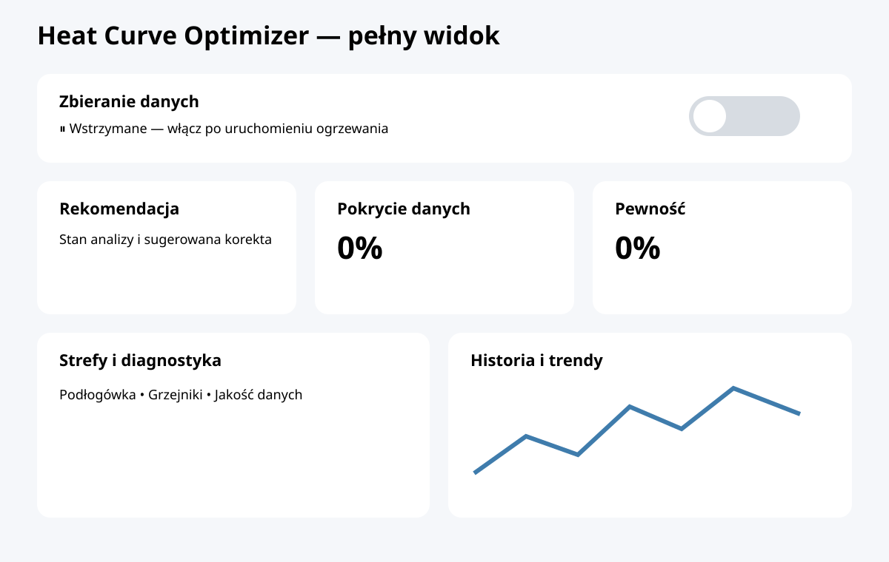
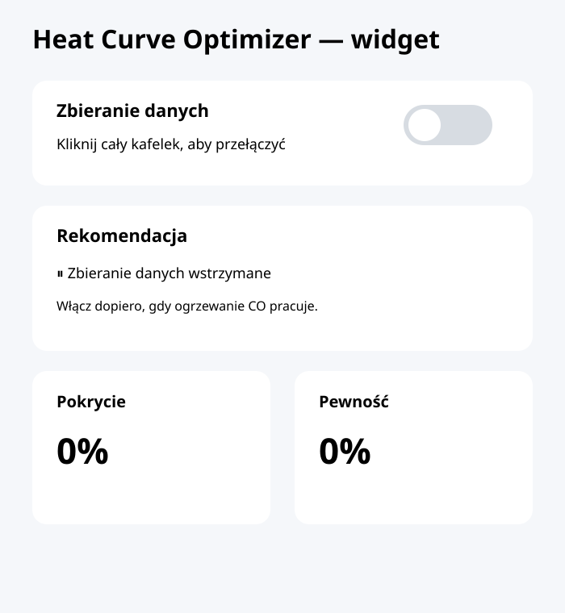

# Heat Curve Optimizer

Experimental, **read-only** Home Assistant custom integration for conservative heating-curve recommendations. Version 0.2 models underfloor heating and radiators as separate observation zones while producing one recommendation for installations where both zones share the same supply temperature.

## Installation through HACS

1. Back up Home Assistant.
2. Open HACS → Custom repositories.
3. Add `https://github.com/kamiljaworski88/Heat-Curve-Optimizer` as **Integration**.
4. Install the integration, restart Home Assistant and go to Settings → Devices & services → Add integration → Heat Curve Optimizer.
5. Select outdoor and target temperature entities and at least one floor or radiator room temperature entity.
6. Turn on **Data collection** only when the heating system is actually running.
7. Allow a full analysis window to accumulate before acting on advice.

**Polska instrukcja:** [docs/INSTRUKCJA_PL.md](docs/INSTRUKCJA_PL.md)

## Dashboard — two variants

Choose the variant that fits your Home Assistant setup:

- **Full dashboard/view:** [dashboard/heat_curve_optimizer.yaml](dashboard/heat_curve_optimizer.yaml) — complete Lovelace dashboard with control, recommendation, diagnostics and history.
- **Compact widget:** [dashboard/heat_curve_optimizer_widget.yaml](dashboard/heat_curve_optimizer_widget.yaml) — a small `vertical-stack` card that can be pasted into an existing view.

In both variants the whole **Data collection** tile is clickable and toggles the switch. Adjust generated entity IDs if Home Assistant created different IDs.\n\n### Screenshots / previews\n\n**Full dashboard**\n\n\n\n**Compact widget**\n\n\n\n> These are interface previews. Actual values and entity states depend on your Home Assistant installation.

**Beta candidate notes:** [docs/RELEASE_NOTES_0.1.0-beta.md](docs/RELEASE_NOTES_0.1.0-beta.md). This document is not a published GitHub release.

## v0.2 decision model

Version 0.2 assumes **one shared supply temperature** for underfloor heating and radiators:

- both zones are measured separately;
- a clearly underheated zone has priority when the other zone remains inside the comfort deadband;
- lowering is allowed only when no zone is underheated;
- simultaneous material underheating and overheating produces `zone_conflict` instead of averaging the errors;
- outdoor temperature stability affects whether a recommendation is considered safe;
- recommendation attributes expose the governing zone, weather context and a human-readable reason.

This remains advisory only: v0.2 does not automatically change heating settings.

## v0.3-v0.5 learning roadmap implemented

- **v0.3 — history and thermal response:** persists compact recommendation snapshots and estimates observed response time only from comparable outdoor conditions.
- **v0.4 — house profile:** groups repeated observations into 5 °C outdoor-temperature bands. A band is shown only after at least three observations; it is descriptive, not automatic control.
- **v0.5 — change evaluation:** supports an explicitly registered applied curve/offset change and evaluates it only after at least 12 hours under comparable outdoor conditions (within 2 °C).

The shared-supply safety model from v0.2 remains authoritative. Learning never overrides `zone_conflict`, insufficient data, or unstable conditions. Automatic control is still intentionally out of scope.

## Tests

The workflow in `.github/workflows/tests.yml` runs `python -m pytest -q tests`, Python compilation and a manifest check. Tests use mock Aqara/Supla states and fake Home Assistant services, not physical devices or a full Home Assistant runtime. Check the actual Actions run result before installing the beta.

## Safety and privacy

No automatic heat-pump control. The current heuristic suggests a preliminary **offset**, not a calibrated slope. Thermostats, floor actuators, air conditioning, occupancy and pump heating mode are not modeled sufficiently for automatic decisions.

Never commit secrets, tokens, real household entity IDs or `.storage` files. Samples are stored locally in Home Assistant. Data collection can be paused from the integration switch; while paused, no samples are added and coverage does not increase. Existing valid history is preserved. Upgrading from the pre-switch storage schema discards the old uncontrolled sample history once and starts paused. Inspect diagnostics before sharing.

## Known limitations

- Optional supply/return, power and operation-state entities are selectable but not yet used for recommendations.
- Sensor update age is not yet checked; frozen but numeric states may be misleading.
- v0.2 evaluates weather stability inside the current analysis window; historical weather-bucket learning is planned for a later version.
- Room-specific targets and AC/thermostat demand signals are not modeled.
- HACS installation, actual restart and GitHub Actions green status must be verified before calling the release ready.
